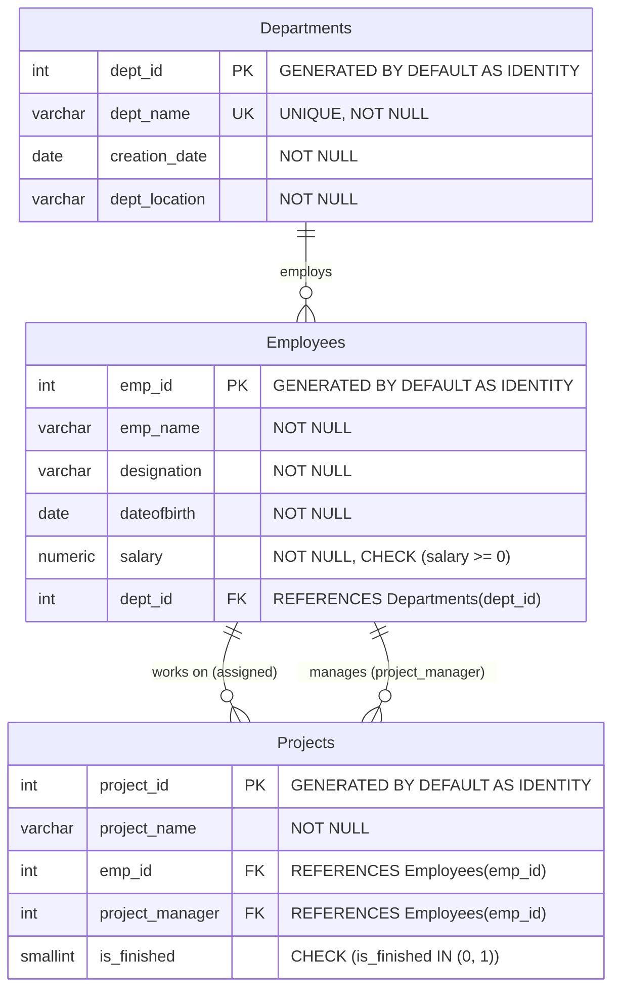

# NaziharDB - Complete PostgreSQL Database Implementation

A comprehensive implementation of **NaziharDB** in **PostgreSQL (v12+)**, covering database architecture, schema creation with strict relational constraints, sample dataset insertion, and solutions for all 23 queries across SQL concepts.

---

## 📁 Repository Structure

| File | Description |
| :--- | :--- |
| [`01_schema_creation.sql`](file:///c:/nub/software-development/01_schema_creation.sql) | DDL script creating `Departments`, `Employees`, and `Projects` tables with complete business rules, primary keys, foreign keys, and check constraints. |
| [`02_data_insertion.sql`](file:///c:/nub/software-development/02_data_insertion.sql) | DML script inserting all 6 departments, 30 employees, and 12 projects, plus auto-increment sequence resynchronization. |
| [`03_queries.sql`](file:///c:/nub/software-development/03_queries.sql) | All 23 SQL queries organized into sections (Basic SELECT/WHERE, ORDER BY/LIMIT/DISTINCT, Aggregates, GROUP BY/HAVING, INNER JOIN, LEFT JOIN, CASE, Subqueries). |
| [`all_in_one_solution.sql`](file:///c:/nub/software-development/all_in_one_solution.sql) | A single turnkey script executing the entire schema creation, data insertion, and all 23 queries consecutively. |

---

## 📊 Entity Relationship Diagram (ERD)



---

## 📋 Business Rules & Constraint Compliance Matrix

| # | Rule Description | PostgreSQL Implementation Detail |
|---|---|---|
| **1** | Unique department ID and unique department name | `dept_id INT GENERATED BY DEFAULT AS IDENTITY PRIMARY KEY`, `dept_name VARCHAR(100) NOT NULL UNIQUE` |
| **2** | Department name and creation date are mandatory | `dept_name VARCHAR(100) NOT NULL`, `creation_date DATE NOT NULL` |
| **3** | Unique employee ID | `emp_id INT GENERATED BY DEFAULT AS IDENTITY PRIMARY KEY` |
| **4** | Employee may belong to one department | `dept_id INT REFERENCES Departments(dept_id) ON DELETE SET NULL ON UPDATE CASCADE` |
| **5** | Unique project ID | `project_id INT GENERATED BY DEFAULT AS IDENTITY PRIMARY KEY` |
| **6** | Project name is mandatory | `project_name VARCHAR(150) NOT NULL` |
| **7** | A project must have one project manager | `project_manager INT NOT NULL` |
| **8** | Project manager must be an employee of the organization | `CONSTRAINT fk_projects_manager FOREIGN KEY (project_manager) REFERENCES Employees(emp_id) ON DELETE RESTRICT ON UPDATE CASCADE` |
| **9** | A project may have one employee working on it | `emp_id INT REFERENCES Employees(emp_id) ON DELETE SET NULL ON UPDATE CASCADE` |
| **10**| An employee may work on multiple projects | Supported naturally via 1-to-many relationship from `Employees` to `Projects` |
| **11**| IDs should be generated automatically | `INT GENERATED BY DEFAULT AS IDENTITY` (Standard SQL compliant auto-increment) |
| **12**| Choose suitable data types | `DATE` for dates, `NUMERIC(10, 2)` for monetary values, `VARCHAR` for strings, `SMALLINT` with check `(0, 1)` for boolean flag |
| **13**| Maintain proper relationships | Strict Foreign Keys with appropriate `ON DELETE` / `ON UPDATE` actions |

---

## 🚀 How to Execute in PostgreSQL

### Method 1: Using `psql` (Command Line)
1. Open PowerShell / Command Prompt or Terminal.
2. Connect to PostgreSQL and create the database:
   ```bash
   psql -U postgres
   ```
   ```sql
   CREATE DATABASE "NaziharDB";
   \c "NaziharDB";
   ```
3. Run the scripts:
   ```bash
   psql -U postgres -d NaziharDB -f "c:\nub\software-development\01_schema_creation.sql"
   psql -U postgres -d NaziharDB -f "c:\nub\software-development\02_data_insertion.sql"
   psql -U postgres -d NaziharDB -f "c:\nub\software-development\03_queries.sql"
   ```
   *Or run everything in one step:*
   ```bash
   psql -U postgres -d NaziharDB -f "c:\nub\software-development\all_in_one_solution.sql"
   ```

### Method 2: Using pgAdmin 4
1. Open **pgAdmin 4** and connect to your PostgreSQL server.
2. Right-click **Databases** -> **Create** -> **Database...**, name it `NaziharDB`, and click **Save**.
3. Select `NaziharDB`, open the **Query Tool** (`Alt + Shift + Q`).
4. Open or paste [`all_in_one_solution.sql`](file:///c:/nub/software-development/all_in_one_solution.sql) and press **F5** (Execute).

### Method 3: Using DBeaver / VS Code
1. Connect to PostgreSQL.
2. Execute `CREATE DATABASE "NaziharDB";`.
3. Open [`all_in_one_solution.sql`](file:///c:/nub/software-development/all_in_one_solution.sql) in the SQL editor connected to `NaziharDB` and run all statements (`Ctrl + Alt + X` or `Execute Script`).

---

## 📑 Query Catalog and Expected Results

### Part C — Section 1: Basic SELECT, WHERE, LIKE, IN, BETWEEN

#### Query 1: Display all departments located in Dhaka, ordered by department name.
```sql
SELECT 
    dept_id,
    dept_name,
    creation_date,
    dept_location
FROM Departments
WHERE dept_location = 'Dhaka'
ORDER BY dept_name ASC;
```
**Expected Output (4 rows):**
| dept_id | dept_name | creation_date | dept_location |
|:---:|:---|:---:|:---|
| 2 | Human Resources | 2016-03-20 | Dhaka |
| 1 | Information Technology | 2015-01-15 | Dhaka |
| 4 | Marketing | 2018-05-18 | Dhaka |
| 6 | Research and Development | 2020-04-12 | Dhaka |

---

#### Query 2: Display the name, designation, and salary of employees whose salary is between 50,000 and 80,000.
```sql
SELECT 
    emp_name,
    designation,
    salary
FROM Employees
WHERE salary BETWEEN 50000 AND 80000
ORDER BY salary DESC;
```
**Expected Output (16 rows):**
| emp_name | designation | salary |
|:---|:---|:---:|
| Sadia Rahman | Marketing Manager | 80000.00 |
| Sakib Khan | Database Administrator | 78000.00 |
| Farhana Akter | Admin Manager | 78000.00 |
| Nusrat Sultana | HR Manager | 75000.00 |
| Nayeem Hasan | Research Scientist | 75000.00 |
| Tanvir Ahmed | System Analyst | 72000.00 |
| Ayesha Rahman | Senior Accountant | 70000.00 |
| Abir Hasan | Software Engineer | 65000.00 |
| Sumaiya Islam | Financial Analyst | 62000.00 |
| Fahim Rahman | Network Engineer | 60000.00 |
| Tasnim Jahan | Research Officer | 60000.00 |
| Morshed Alam | Administrative Officer | 58000.00 |
| Mim Akter | Software Engineer | 55000.00 |
| Rakib Hossain | Accountant | 55000.00 |
| Priya Das | Administrative Officer | 55000.00 |
| Arif Rahman | Marketing Executive | 52000.00 |

---

#### Query 3: Display all employees whose name starts with 'A' or contains 'Rahman'.
```sql
SELECT 
    emp_id,
    emp_name,
    designation,
    salary,
    dept_id
FROM Employees
WHERE emp_name LIKE 'A%' 
   OR emp_name LIKE '%Rahman%'
ORDER BY emp_id ASC;
```
**Expected Output (7 rows):**
| emp_id | emp_name | designation | salary | dept_id |
|:---:|:---|:---|:---:|:---:|
| 1 | Abir Hasan | Software Engineer | 65000.00 | 1 |
| 6 | Fahim Rahman | Network Engineer | 60000.00 | 1 |
| 13 | Ayesha Rahman | Senior Accountant | 70000.00 | 3 |
| 17 | Sadia Rahman | Marketing Manager | 80000.00 | 4 |
| 18 | Arif Rahman | Marketing Executive | 52000.00 | 4 |
| 26 | Afsana Yasmin | Research Manager | 88000.00 | 6 |
| 29 | Sohanur Rahman | Data Scientist | 82000.00 | 6 |

---

#### Query 4: Display all projects that are either completed or assigned to employee ID 1.
```sql
SELECT 
    project_id,
    project_name,
    emp_id,
    project_manager,
    is_finished
FROM Projects
WHERE is_finished = 1 
   OR emp_id = 1
ORDER BY project_id ASC;
```
**Expected Output (5 rows):**
| project_id | project_name | emp_id | project_manager | is_finished |
|:---:|:---|:---:|:---:|:---:|
| 1 | Payroll Management System | 1 | 2 | 1 |
| 4 | Recruitment Management System | 9 | 8 | 1 |
| 6 | Financial Reporting System | 12 | 12 | 1 |
| 8 | Digital Marketing Campaign | 17 | 16 | 1 |
| 10 | Office Automation System | 21 | 21 | 1 |

---

### Part C — Section 2: ORDER BY, LIMIT, DISTINCT

#### Query 5: Display the 5 highest-paid employees.
```sql
SELECT 
    emp_id,
    emp_name,
    designation,
    salary,
    dept_id
FROM Employees
ORDER BY salary DESC
LIMIT 5;
```
**Expected Output (5 rows):**
| emp_id | emp_name | designation | salary | dept_id |
|:---:|:---|:---|:---:|:---:|
| 12 | Mehedi Hasan | Finance Manager | 90000.00 | 3 |
| 26 | Afsana Yasmin | Research Manager | 88000.00 | 6 |
| 2 | Nusrat Jahan | Senior Software Engineer | 85000.00 | 1 |
| 29 | Sohanur Rahman | Data Scientist | 82000.00 | 6 |
| 17 | Sadia Rahman | Marketing Manager | 80000.00 | 4 |

---

#### Query 6: Display all unique locations from the departments table.
```sql
SELECT DISTINCT 
    dept_location
FROM Departments
ORDER BY dept_location ASC;
```
**Expected Output (3 rows):**
| dept_location |
|:---|
| Chittagong |
| Dhaka |
| Rajshahi |

---

#### Query 7: Display the 3 most recently created departments.
```sql
SELECT 
    dept_id,
    dept_name,
    creation_date,
    dept_location
FROM Departments
ORDER BY creation_date DESC
LIMIT 3;
```
**Expected Output (3 rows):**
| dept_id | dept_name | creation_date | dept_location |
|:---:|:---|:---:|:---|
| 6 | Research and Development | 2020-04-12 | Dhaka |
| 5 | Administration | 2019-01-25 | Rajshahi |
| 4 | Marketing | 2018-05-18 | Dhaka |

---

### Part C — Section 3: Aggregate Functions

#### Query 8: Find the total number of employees, total salary, average salary, highest salary, and lowest salary.
```sql
SELECT 
    COUNT(*) AS total_employees,
    SUM(salary) AS total_salary,
    ROUND(AVG(salary), 2) AS average_salary,
    MAX(salary) AS highest_salary,
    MIN(salary) AS lowest_salary
FROM Employees;
```
**Expected Output (1 row):**
| total_employees | total_salary | average_salary | highest_salary | lowest_salary |
|:---:|:---:|:---:|:---:|:---:|
| 30 | 1830000.00 | 61000.00 | 90000.00 | 35000.00 |

---

#### Query 9: Find the total number of completed and running projects separately.
```sql
SELECT 
    CASE 
        WHEN is_finished = 1 THEN 'Completed'
        WHEN is_finished = 0 THEN 'Running'
    END AS project_status,
    COUNT(*) AS total_projects
FROM Projects
GROUP BY is_finished
ORDER BY is_finished DESC;
```
**Expected Output (2 rows):**
| project_status | total_projects |
|:---|:---:|
| Completed | 5 |
| Running | 7 |

---

### Part C — Section 4: GROUP BY and HAVING

#### Query 10: Display each department's name, number of employees, and average salary.
```sql
SELECT 
    d.dept_name,
    COUNT(e.emp_id) AS number_of_employees,
    ROUND(AVG(e.salary), 2) AS average_salary
FROM Departments d
JOIN Employees e ON d.dept_id = e.dept_id
GROUP BY d.dept_id, d.dept_name
ORDER BY d.dept_id ASC;
```
**Expected Output (6 rows):**
| dept_name | number_of_employees | average_salary |
|:---|:---:|:---:|
| Information Technology | 7 | 65285.71 |
| Human Resources | 4 | 52000.00 |
| Finance | 5 | 63800.00 |
| Marketing | 4 | 56250.00 |
| Administration | 5 | 54200.00 |
| Research and Development | 5 | 70000.00 |

---

#### Query 11: Display departments having more than 4 employees.
```sql
SELECT 
    d.dept_name,
    COUNT(e.emp_id) AS number_of_employees
FROM Departments d
JOIN Employees e ON d.dept_id = e.dept_id
GROUP BY d.dept_id, d.dept_name
HAVING COUNT(e.emp_id) > 4
ORDER BY number_of_employees DESC;
```
**Expected Output (4 rows):**
| dept_name | number_of_employees |
|:---|:---:|
| Information Technology | 7 |
| Finance | 5 |
| Administration | 5 |
| Research and Development | 5 |

---

#### Query 12: Display each department's name and total salary, but show only departments whose total salary is greater than 300,000.
```sql
SELECT 
    d.dept_name,
    SUM(e.salary) AS total_salary
FROM Departments d
JOIN Employees e ON d.dept_id = e.dept_id
GROUP BY d.dept_id, d.dept_name
HAVING SUM(e.salary) > 300000
ORDER BY total_salary DESC;
```
**Expected Output (3 rows):**
| dept_name | total_salary |
|:---|:---:|
| Information Technology | 457000.00 |
| Research and Development | 350000.00 |
| Finance | 319000.00 |

---

#### Query 13: Display each project manager's employee ID and the number of projects they manage. Show only managers who manage more than one project.
```sql
SELECT 
    project_manager AS manager_emp_id,
    COUNT(*) AS total_projects_managed
FROM Projects
GROUP BY project_manager
HAVING COUNT(*) > 1
ORDER BY total_projects_managed DESC, project_manager ASC;
```
**Expected Output (5 rows):**
| manager_emp_id | total_projects_managed |
|:---:|:---:|
| 2 | 2 |
| 8 | 2 |
| 12 | 2 |
| 16 | 2 |
| 26 | 2 |

---

### Part C — Section 5: INNER JOIN

#### Query 14: Display employee name, designation, salary, and department name.
```sql
SELECT 
    e.emp_name,
    e.designation,
    e.salary,
    d.dept_name
FROM Employees e
INNER JOIN Departments d ON e.dept_id = d.dept_id
ORDER BY e.emp_id ASC;
```
**Expected Output (30 rows):** All 30 employees displayed alongside their designated department name.

---

#### Query 15: Display project name, assigned employee name, and department name.
```sql
SELECT 
    p.project_name,
    e.emp_name AS assigned_employee_name,
    d.dept_name
FROM Projects p
INNER JOIN Employees e ON p.emp_id = e.emp_id
INNER JOIN Departments d ON e.dept_id = d.dept_id
ORDER BY p.project_id ASC;
```
**Expected Output (12 rows):**
| project_name | assigned_employee_name | dept_name |
|:---|:---|:---|
| Payroll Management System | Abir Hasan | Information Technology |
| Network Infrastructure Upgrade | Fahim Rahman | Information Technology |
| Database Migration Project | Sakib Khan | Information Technology |
| Recruitment Management System | Jannatul Ferdous | Human Resources |
| Employee Training Portal | Tania Akter | Human Resources |
| Financial Reporting System | Mehedi Hasan | Finance |
| Budget Management System | Ayesha Rahman | Finance |
| Digital Marketing Campaign | Sadia Rahman | Marketing |
| Company Website Redesign | Arif Rahman | Marketing |
| Office Automation System | Farhana Akter | Administration |
| Research Data Management System | Afsana Yasmin | Research and Development |
| AI Research Project | Nayeem Hasan | Research and Development |

---

#### Query 16: Display project name, assigned employee name, employee salary, department name, and project status.
```sql
SELECT 
    p.project_name,
    e.emp_name AS assigned_employee_name,
    e.salary AS employee_salary,
    d.dept_name,
    CASE 
        WHEN p.is_finished = 1 THEN 'Completed'
        WHEN p.is_finished = 0 THEN 'Running'
    END AS project_status
FROM Projects p
INNER JOIN Employees e ON p.emp_id = e.emp_id
INNER JOIN Departments d ON e.dept_id = d.dept_id
ORDER BY p.project_id ASC;
```
**Expected Output (12 rows):** Displays the project title, assigned employee name, salary, department name, and the human-readable project status (`Completed` or `Running`).

---

### Part C — Section 6: LEFT JOIN

#### Query 17: Display all employees and their project names, including employees who are not assigned to any project.
```sql
SELECT 
    e.emp_name,
    p.project_name
FROM Employees e
LEFT JOIN Projects p ON e.emp_id = p.emp_id
ORDER BY e.emp_id ASC;
```
**Expected Output (30 rows):** Returns 12 rows with project assignments and 18 rows with `NULL` in `project_name` for employees not currently assigned to a project.

---

#### Query 18: Display all departments and the number of employees in each department, including departments with zero employees.
```sql
SELECT 
    d.dept_name,
    COUNT(e.emp_id) AS number_of_employees
FROM Departments d
LEFT JOIN Employees e ON d.dept_id = e.dept_id
GROUP BY d.dept_id, d.dept_name
ORDER BY d.dept_id ASC;
```
**Expected Output (6 rows):**
| dept_name | number_of_employees |
|:---|:---:|
| Information Technology | 7 |
| Human Resources | 4 |
| Finance | 5 |
| Marketing | 4 |
| Administration | 5 |
| Research and Development | 5 |

---

#### Query 19: Display employees who are not assigned to any project.
```sql
SELECT 
    e.emp_id,
    e.emp_name,
    e.designation,
    e.salary
FROM Employees e
LEFT JOIN Projects p ON e.emp_id = p.emp_id
WHERE p.project_id IS NULL
ORDER BY e.emp_id ASC;
```
**Expected Output (18 rows):** Employees 2, 3, 5, 7, 8, 11, 14, 15, 16, 19, 20, 22, 23, 24, 25, 28, 29, and 30.

---

### Part C — Section 7: CASE Expressions

#### Query 20: Display employee name, salary, and salary category using CASE:
- `Salary >= 80,000` → **High**
- `Salary >= 60,000` → **Medium**
- `Otherwise` → **Low**
```sql
SELECT 
    emp_name,
    salary,
    CASE 
        WHEN salary >= 80000 THEN 'High'
        WHEN salary >= 60000 THEN 'Medium'
        ELSE 'Low'
    END AS salary_category
FROM Employees
ORDER BY salary DESC, emp_name ASC;
```
**Expected Output (30 rows):**
- **High (5 employees):** Mehedi Hasan (90k), Afsana Yasmin (88k), Nusrat Jahan (85k), Sohanur Rahman (82k), Sadia Rahman (80k).
- **Medium (8 employees):** Sakib Khan (78k), Farhana Akter (78k), Nusrat Sultana (75k), Nayeem Hasan (75k), Tanvir Ahmed (72k), Ayesha Rahman (70k), Abir Hasan (65k), Sumaiya Islam (62k), Fahim Rahman (60k), Tasnim Jahan (60k).
- **Low (15 employees):** All employees with salary < 60,000.

---

#### Query 21: Display project name and project status using CASE:
- `is_finished = 1` → **Completed**
- `is_finished = 0` → **Running**
```sql
SELECT 
    project_name,
    CASE 
        WHEN is_finished = 1 THEN 'Completed'
        WHEN is_finished = 0 THEN 'Running'
        ELSE 'Unknown'
    END AS project_status
FROM Projects
ORDER BY project_id ASC;
```
**Expected Output (12 rows):** All 12 project names mapped cleanly to 'Completed' (5 projects) and 'Running' (7 projects).

---

### Part C — Section 8: Subqueries

#### Query 22: Display employees whose salary is greater than the average salary of all employees.
```sql
SELECT 
    emp_id,
    emp_name,
    designation,
    salary
FROM Employees
WHERE salary > (
    SELECT AVG(salary) 
    FROM Employees
)
ORDER BY salary DESC;
```
*Note: Average salary is 61,000.00.*
**Expected Output (13 rows):**
| emp_id | emp_name | designation | salary |
|:---:|:---|:---|:---:|
| 12 | Mehedi Hasan | Finance Manager | 90000.00 |
| 26 | Afsana Yasmin | Research Manager | 88000.00 |
| 2 | Nusrat Jahan | Senior Software Engineer | 85000.00 |
| 29 | Sohanur Rahman | Data Scientist | 82000.00 |
| 17 | Sadia Rahman | Marketing Manager | 80000.00 |
| 4 | Sakib Khan | Database Administrator | 78000.00 |
| 21 | Farhana Akter | Admin Manager | 78000.00 |
| 8 | Nusrat Sultana | HR Manager | 75000.00 |
| 27 | Nayeem Hasan | Research Scientist | 75000.00 |
| 3 | Tanvir Ahmed | System Analyst | 72000.00 |
| 13 | Ayesha Rahman | Senior Accountant | 70000.00 |
| 1 | Abir Hasan | Software Engineer | 65000.00 |
| 15 | Sumaiya Islam | Financial Analyst | 62000.00 |

---

#### Query 23: Display the highest-paid employee from each department along with the department name.
```sql
SELECT 
    e.emp_name,
    e.salary,
    d.dept_name
FROM Employees e
JOIN Departments d ON e.dept_id = d.dept_id
WHERE (e.dept_id, e.salary) IN (
    SELECT dept_id, MAX(salary)
    FROM Employees
    GROUP BY dept_id
)
ORDER BY e.salary DESC;
```
**Expected Output (6 rows):**
| emp_name | salary | dept_name |
|:---|:---:|:---|
| Mehedi Hasan | 90000.00 | Finance |
| Afsana Yasmin | 88000.00 | Research and Development |
| Nusrat Jahan | 85000.00 | Information Technology |
| Sadia Rahman | 80000.00 | Marketing |
| Farhana Akter | 78000.00 | Administration |
| Nusrat Sultana | 75000.00 | Human Resources |
